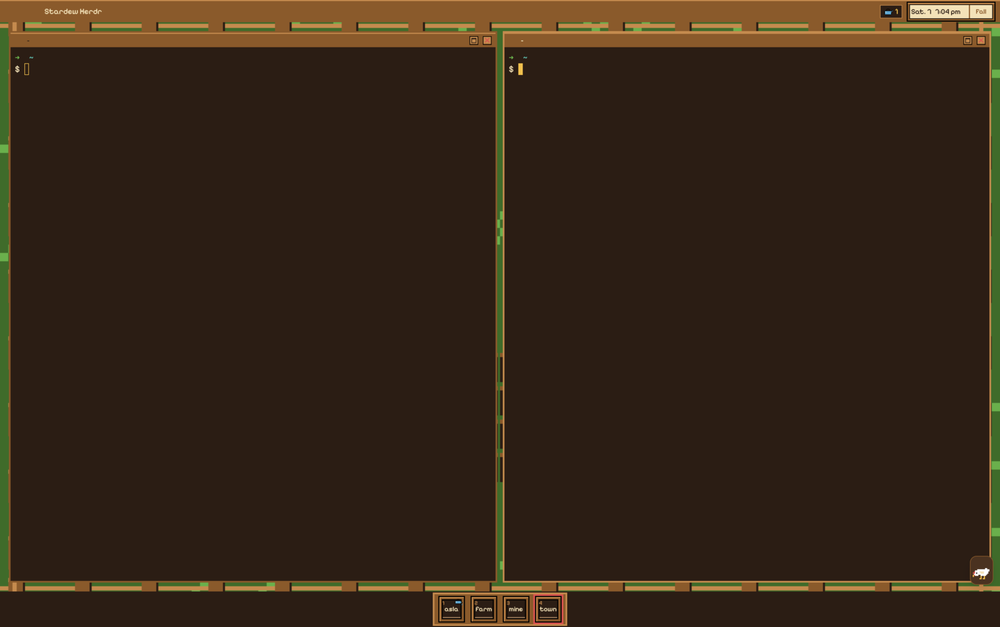
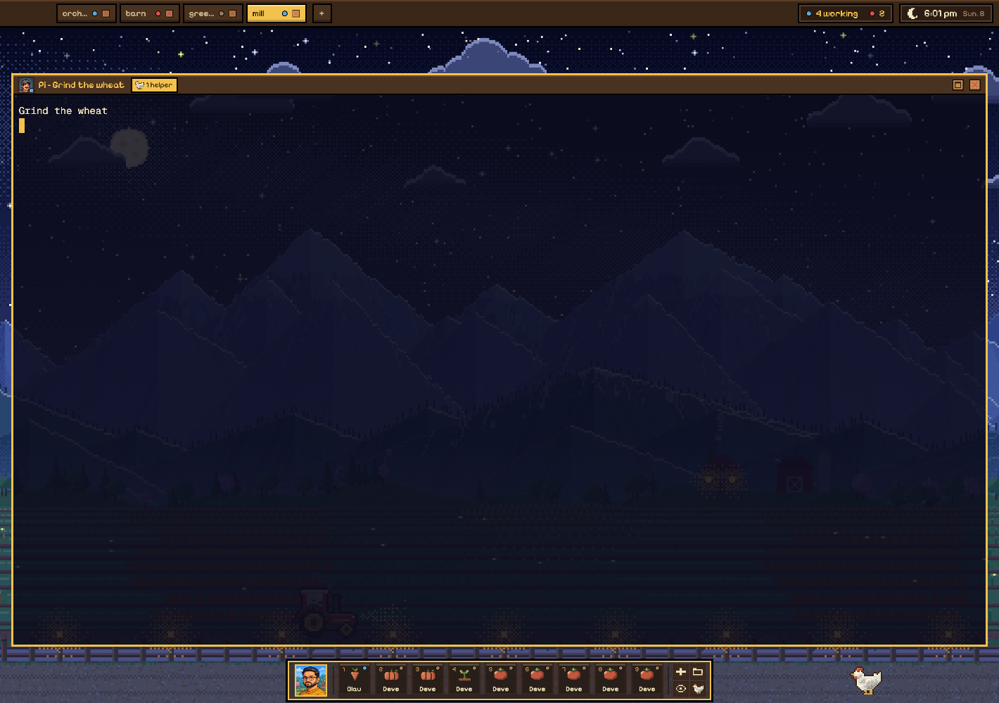
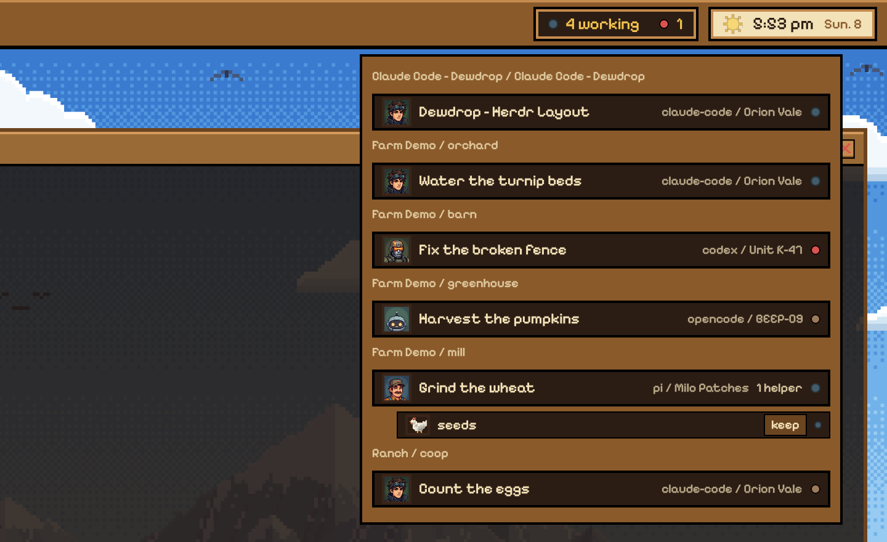
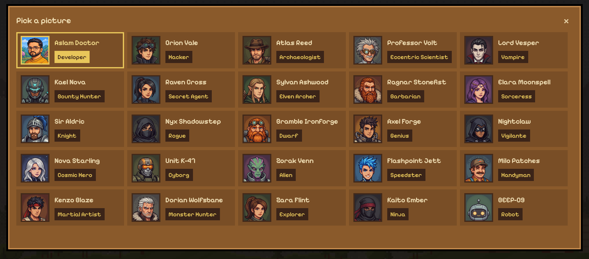
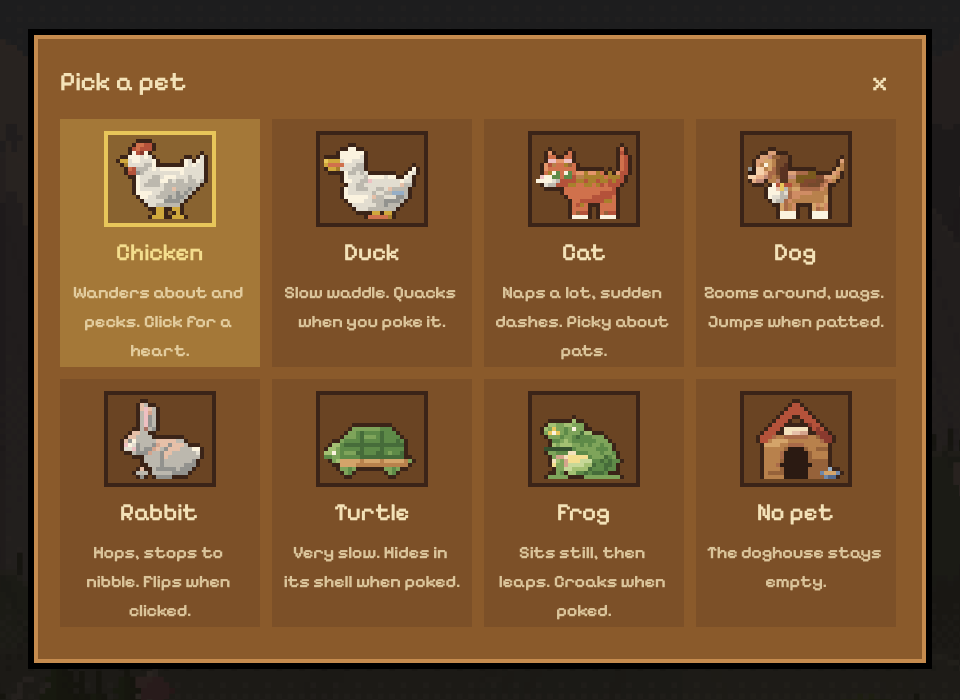
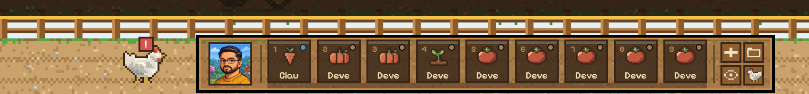
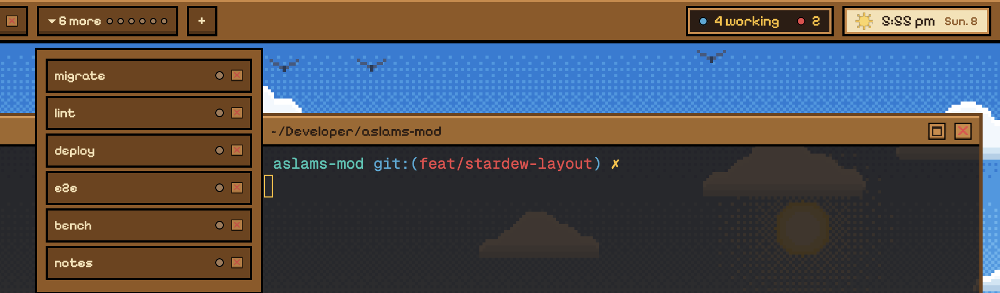

# Dewdrop

A Stardew-inspired farm layout for the Herdr desktop app. Your terminals sit in front of a pixel-art valley that changes from day to night with your clock. Spaces show up as crop slots on a hotbar, agents get farmhand faces, and a small pet walks the road under it all.



## Features

### Day and night

The valley follows your local clock. From 6 am to 6 pm it's a sunny morning with clouds and birds in the sky strip above the panes. After 6 pm the scene, the pane colors and the sky switch to a starry night with fireflies, and it goes back at 6 am.



### Agents dropdown

The "working" chip in the title bar counts busy agents and their helpers. Click it to see every agent grouped by space and tab, with its face, title, app and status dot. Helpers an agent started with `hc run` are nested under it, with a "keep" button to give one its own pane. Click a row to jump to that agent.



Each agent app gets its own farmhand:

| App | Farmhand |
|-----|----------|
| claude-code | Orion Vale |
| codex | Unit K-47 |
| opencode | BEEP-09 |
| anything else | Milo Patches |

### Portrait picker

Click the portrait at the left of the hotbar to pick your own picture from 25 characters, each with a name and a role.



### Pet picker

The pet button at the right end of the hotbar opens the pet picker. There are seven pets (chicken, duck, cat, dog, rabbit, turtle and frog), or you can leave the doghouse empty.



### The road pet

The pet lives on the road behind the hotbar. It wanders, dashes, and does its own thing: the cat naps, the chicken pecks, the dog wags, the turtle hides in its shell. Click it and it reacts. You can also pick it up, carry it and drop it somewhere else.

It keeps an eye on your agents too. A red "!" pops up over its head when one gets blocked, and a heart when one finishes. Click the pet while the badge shows to jump to that agent.



### Tabs in the title bar

Tabs sit in a wooden title bar with a status dot and a close button each. Hover a tab to see its full name. When there are more tabs than fit, a "more" chip lists the rest, including settled ones.



### Hotbar

- Every space is a slot with its own crop. Click one to switch to it, or hover it to see its agents.
- "+" opens a new tab, and the folder button starts a new space in a folder you pick.
- The eye button hides the panes so you can look at the valley.
- Past nine spaces the row scrolls sideways.

## Install

You need the Herdr desktop app (built against 0.1.13) and [Bun](https://bun.sh).

```sh
git clone https://github.com/aslamdoctor/dewdrop.git
cd dewdrop
bash scripts/install.sh
```

The script copies `layouts/dewdrop.json`, `themes/dewdrop.json` and `mods/dewdrop/` into `~/.config/herdr-app` (or `$HERDR_APP_HOME`). Then switch to it:

```sh
herdr-app do layout.switch --name dewdrop
```

Run `bash scripts/install.sh --remove` to take it out again.

## Development

| Command | What it does |
|---------|--------------|
| `bun test` | runs the tests |
| `herdr-app check mods/dewdrop` | loads the mod once and reports errors |
| `bash scripts/install.sh` | copies the mod into the Herdr home (touch the installed `.js` files after so Herdr reloads them) |
| `bun scripts/draw-scenes.js` | redraws the valley backgrounds |

[RECIPE.md](RECIPE.md) describes the layout in enough detail for an agent to rebuild it from an empty folder.

Want to help? See [CONTRIBUTING.md](CONTRIBUTING.md) for setup, testing and how to send a pull request.

## License

[MIT](LICENSE)
