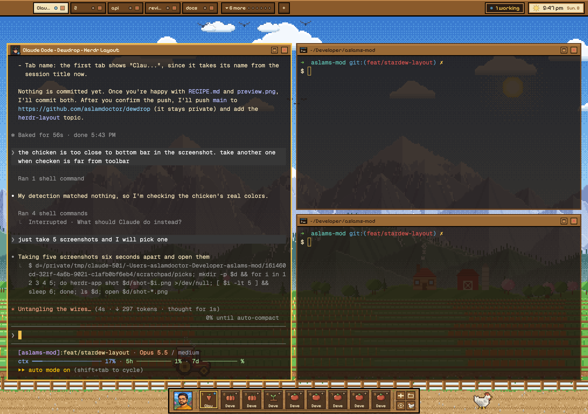

# Dewdrop

A 16-bit farm window for the Herdr desktop app. Behind the terminals sits a pixel-art valley with a farmhouse, a barn, a field and a tractor, and it turns from a sunny morning into a starry night at 6 pm (and back at 6 am). Tabs sit in a wooden title bar. A thin strip of sky over the panes has drifting clouds and flapping birds by day, twinkling stars and fireflies at night. Every space is a crop slot on a hotbar at the bottom, every agent gets a farmhand face, and a small pet walks the road behind the hotbar. The pet shows a heart when an agent finishes and a red "!" when one is blocked. You can click it or pick it up and drop it.



## What you see

Palette: soil `#2b1d14`, parchment `#f3e2b8`, wood `#8a5a2b`, wood light `#c58b4e`, grass `#6ab04c`, dark grass `#3f6b2a`, sky `#5fa8d3`, red `#d9534f`, gold `#f2c14e`, idle brown `#9c7b5b`, ink `#3b2418`, gold line `#e8c65a`. UI type is Pixelify Sans (bundled), terminal type is Geist Mono 14px. Nearly every box has a 2px black border, which gives the chunky pixel look.

The look follows the local clock: day from 6:00 to 17:59, night otherwise.

| Part | Day | Night |
|------|-----|-------|
| Valley | `scene/day-<rows>.png`, morning valley, chimney smoke, birds | `scene/night-<rows>.png`, stars, tractor headlight, fireflies |
| Title bar | wood `#8a5a2b`, top line `#c58b4e` | dark wood `#3a2718`, top line `#5a3c25` |
| Selected tab | parchment `#f3e2b8` on soil text | gold `#f2c14e` on soil text |
| Other tabs | `#6b4420`, parchment text | `#4a3220`, `#c9b48a` text |
| Pane header plank | `#9a6a36`, top line `#d29a5c`, focused title `#fff4d6` | `#4a3220`, top line `#6b4a30`, focused title gold |
| Pane fill | `#20160fdb` | `#0b0b1ad6` |
| Pane border | 3px `#6b4420` | 3px `#2b1d14` |
| Focus ring | 3px gold `#f2c14e` | 3px gold `#f2c14e` |
| Hotbar trim | `#c58b4e` | gold `#f2c14e` |
| Sky strip | clouds and birds | stars and fireflies |

Top to bottom:

- **Title bar, 40px.** A 3px black line under it. 80px on the left are left free for the traffic lights (placed at 14, 11). Then the shown space's tabs, a "more" chip, a "+" chip, a gap, the working chip and the clock box. The whole bar drags the window.
  - Tab chips are 28px tall, 86px wide (they shrink to 52px), with the tab's name (or its number when it has none), a status dot and a 12px close button. A long name is cut with "...". Up to five fit. The chosen tab has a light 2px line at the top, and every chip has a dark 3px line at the bottom.
  - "▾ N more" holds the live tabs past the fifth and the settled tabs, with one small dot per hidden live tab.
  - The working chip is soil-colored with gold text: a pulsing blue dot and "N working". When something is blocked, a red dot and the count follow.
  - The clock box is parchment by day and soil at night: a sun or a moon, the time in 14px ("2:32 pm") and the day in 11px ("Sun. 8").
- **Valley.** A column with the scene as its background (`cover` fit). The scene is drawn at 3 points per art pixel, and the art is about 2.4 times as wide as tall, so a wide window crops the sides and a tall one shows more sky and field rather than zooming in.
  - **Sky strip, 48px.** See-through, so the scene shows behind it. Clouds drift at 6 to 12 px/s and birds cross at 30 to 48 px/s while bobbing a few pixels. At night, about one star per 32px twinkles, and fireflies wander small patches while they blink. All sprites are drawn at 3px per art pixel.
  - **Panes.** 16px padding, 10px gaps, square corners, a 3px border and a 3px focus ring. A lone pane keeps its frame. `terminal_opacity` is 0, so the pane fill is the only thing between the text and the scene, and the valley shows faintly through.
  - **Pane header, 28px, always shown.** A wooden plank with a 2px black line under it. It holds a window icon, or for an agent pane, the agent's face (24px) with a status dot on its corner. Then the title in 13px: the program name, plus the terminal title when it differs ("claude - fix tests"). Shells show the working directory, with home written as `~`. When the agent has started helpers, a "N helpers" chip with a little chicken follows. 18px zoom and close buttons sit on the right.
  - **Hotbar, 64px.** One centered wooden box (55% alpha wood with a trim line) on the road at the bottom. Left to right: the portrait (46px), a divider, the space slots, a divider, and a 2x2 grid of 22px tool buttons (new tab, new space, hide panes, choose a pet). A slot is 46px square: the space number (1 to 9) top left, a status dot top right, a 24px crop and the first four letters of the space name. The shown space has a gold inner line.
  - **Road pet.** A 48x40 sprite on the road, behind the hotbar box, roaming the full window width.

The theme matches: soil background, parchment text, `#3a2718` surfaces, `#4a3220` popovers, wood borders and chrome, grass accent, `#3f6b2a` canvas, and the status colors below.

## How it behaves

| Status | Dot |
|--------|-----|
| working | sky `#5fa8d3`, pulsing between 45% and full opacity every 800ms |
| blocked | red `#d9534f` |
| done | gold `#f2c14e` |
| idle (or none) | idle brown `#9c7b5b` |

- **Day and night.** At 6:00 and 18:00, and on start, the mod reads the layout and calls `layout.set` with the other scene and pane colors. It doesn't write on every tick. Only colors and images change, so nothing moves under the mouse. The clock updates on the minute.
- **Window size.** When the window height changes enough to want another scene height, the scene is swapped for the matching file (same look).
- **Tabs.** Click selects (`tab.select`), the close button runs `tab.close`, and "+" runs `tab.new` in the shown space. Hovering a tab shows its full name ("Tab 3" when unnamed). The selected tab always stays in the strip; when it would be sixth or later it takes the fifth spot. "▾ N more" opens a 210px popup under the chip with the hidden live tabs, then a "settled" heading and the settled tabs at 55% opacity. Each row selects, closes and has a tooltip like the chips. It scrolls past 400px.
- **Working chip.** Counts working agents plus helpers. Clicking it opens the agents popup.
- **Agents popup.** 392px wide, 44px from the top and 12px in from the right edge. It lists agents grouped under "space / tab", each with its face, title, "app / farmhand name", a helper count and a dot. Helpers (terminals an agent started with `hc run`) are nested under their agent. Clicking an agent selects its tab and runs `agent.focus`. Clicking a helper runs `terminal.peek`, or `pane.focus` when it already has a pane. "keep" runs `terminal.keep`. With no agents it says "No farmhands at work." It grows to 450px, then scrolls.
- **Header.** Click focuses the pane, double-click zooms it. The zoom button runs `pane.zoom` (tooltip "Zoom" or "Restore"), the close button `pane.close`. The helpers chip opens the agents popup.
- **Hotbar.** Click a slot to switch to that space (`space.select`). A space's crop (carrot, pumpkin, wheat, sprout, tomato, corn) comes from a hash of its id, so it keeps its crop when others close. Hovering a slot shows the space name and one line per agent ("Claude Code: working"), or "no agents". Past nine spaces the row scrolls sideways with a scrollbar under it, and the extra slots get no number. "New space" asks for a folder with `pickFolder`, then runs `space.new`; cancel does nothing. "Hide panes" hides the panes so you can look at the valley, and a second click brings them back (the eye icon closes).
- **Pictures.** Clicking the portrait opens "Pick a picture", a 920x396 dialog with a 5x5 grid: the author's portrait and 24 farmhands with names and roles. The choice is saved in the shared key `dewdrop.picture`. Each agent app gets one face: claude-code is Orion Vale, codex is Unit K-47, opencode is BEEP-09, and anything else is Milo Patches.
- **Pet picker.** The fourth tool button (showing the current pet, or a doghouse) opens "Pick a pet", a 452x320 dialog with chicken, duck, cat, dog, rabbit, turtle, frog and "No pet" in four columns, each with a one-line trait. The choice is saved in the shared key `dewdrop.pet`. Chicken is the default.
- **Road pet.** It walks, stands, dashes at three times its speed, or does its own action, picking a new one every few seconds. Each pet has its own speed (turtle 14 px/s, dog 90) and habits: the cat naps for 5 to 9 seconds with "z z", the duck quacks, the dog wags, the rabbit nibbles, the turtle hides in its shell, the frog sits and says "ribbit". It turns at the ends of the road.
  - Click it and it reacts: the chicken shows a heart, the duck says "quack quack", the dog and rabbit jump with a heart, the turtle hides, the frog croaks and leaps round, and the cat either purrs with a heart or walks off with "..." (always when woken from a nap). Words show in a small parchment bubble on the side with more road.
  - Press and drag it to carry it anywhere inside the hotbar. Let go and it falls to the road, hops once, rests for about a second and carries on. Clicks right after a drop are ignored, so a drop never presses a slot.
  - When an agent turns blocked, a red "!" bobs over its head; when one finishes (to done, or working to idle), a heart. Either lasts 4 seconds, a newer event restarts it, and while it shows, clicking the pet focuses that agent. Agents seen for the first time (after a reload, or a new terminal) don't set it off.
  - It plays no sounds.

## Built from

Layout `layouts/dewdrop.json` (one mod, its copies told apart by `props.role`):

```json
{ "id": "root", "type": "column", "children": [
  { "id": "titlebar", "type": "block", "size": { "px": 40 }, "window_drag": true,
    "content": { "mod": "dewdrop", "props": { "role": "titlebar" } } },
  { "id": "valley", "type": "column",
    "background": { "image": "mods/dewdrop/art/scene/day-460.png", "fit": "cover" },
    "children": [
      { "id": "sky", "type": "block", "size": { "px": 48 }, "content": { "mod": "dewdrop", "props": { "role": "sky" } } },
      { "id": "main", "type": "block", "padding": [16, 16],
        "content": { "tab": "active", "pane": {
          "gap": 10, "radius": 0, "background": "#20160fdb",
          "border": { "width": 3, "color": "#6b4420" }, "focus": { "width": 3, "color": "#f2c14e" }, "lone": true,
          "header": { "content": { "mod": "dewdrop", "props": { "role": "header" } }, "height": 28, "position": "top", "reveal": "always" } } } },
      { "id": "peek-spacer", "type": "block", "hidden": true, "content": { "mod": "dewdrop", "props": { "role": "empty" } } },
      { "id": "hotbar", "type": "block", "size": { "px": 64 }, "content": { "mod": "dewdrop", "props": { "role": "hotbar" } } } ] } ],
  "theme": "dewdrop", "font": "Geist Mono", "font_size": 14, "ui_font": "Pixelify Sans",
  "terminal_padding": [8, 4], "terminal_opacity": 0, "background": "#2b1d14",
  "titlebar": "none", "traffic_lights": [14, 11] }
```

Theme `themes/dewdrop.json`: background `#2b1d14`, foreground `#f3e2b8`, selection `#5fa8d3`, cursor `#f2c14e`, a warm 16-color ANSI set, and colors surface `#3a2718`, popover `#4a3220`, raised and hover `#5a3c25`, border and chrome `#8a5a2b`, input `#c58b4e`, muted `#c9b48a`, dim `#9c7b5b`, accent `#6ab04c` (foreground `#2b1d14`), canvas `#3f6b2a`, and the status colors.

The mod `mods/dewdrop/` (`mod.json` is `{ "place": "none" }`). `main.js` maps roles to classes:

| Role | File | What it does |
|------|------|--------------|
| `titlebar` | `titlebar.js` | tabs, more chip, working chip, clock; `spaces()`, `agents()`, `terminals()`, `panes()`, `tab.select`, `tab.new`, `tab.close`; a timer re-aimed at each minute that also runs the look swap |
| `sky` | `sky.js` | clouds, birds, stars, fireflies as native `.loop()` animations, no script timer |
| `header` | `header.js` | pane plank; `panes()`, `props().pane`, `home()`, `pane.focus`, `pane.zoom`, `pane.close` |
| `hotbar` | `hotbar.js` | portrait, slots, tools, and hosts the road pet (`roadpet.js`); `spaces()`, `space.select`, `space.new` after `pickFolder`, `tab.new`, `layout.show` and `layout.hide` for hiding panes |
| `tabmore` | `tabs.js` | the more-tabs popup; tab chips and dots also live here |
| `agents` | `agents.js` | agents popup; `tab.select`, `agent.focus`, `pane.focus`, `terminal.peek`, `terminal.keep` |
| `picker` | `picker.js` | "Pick a picture" dialog |
| `petpick` | `petpick.js` | "Pick a pet" dialog |
| `empty` | `main.js` | paints nothing (the hidden `peek-spacer`) |

Other files:

| File | Holds |
|------|-------|
| `logic.js` | pure helpers, tested with `bun test`: clock text, look and scene height, the layout swap and its retry guard, tab strip split, agent counts and groups, slot data, sky placement (seeded), road pet segments, drop hop, poke reactions, popup positions |
| `look.js` | runs `layout.set` for the look and scene height |
| `palette.js` | every hex value, the day and night tables, the sprite palette |
| `cast.js` | the 25 pictures and the app faces |
| `pets.js` | the seven pets: frames, walk speeds, habits, picker lines |
| `art.js` | path helpers `art(name)`, `png(name)`, `pic(name)`, `petFrame(pet, frame)`, `petWalk`, `petDo` |

Popups and dialogs open with `openOverlay({ mod: "dewdrop", props: { role }, kind: "popup" | "dialog", frame: "none", at })` and close with `closeOverlay(props().overlay)`. Shared keys: `dewdrop.picture` (0 to 24) and `dewdrop.pet` (a pet key, or `"none"`).

Art, all in `mods/dewdrop/art/`:

| Art | Made by |
|-----|---------|
| SVG sprites (window icons, sun, moon, crops, tool icons, zoom and close, heart, clouds, stars, firefly), `shape-rendering="crispEdges"`, palette colors only | `bun scripts/draw-art.js` |
| `scene/day-<rows>.png` and `scene/night-<rows>.png` for rows 240, 270, 300, 340, 380, 420, 460, 510, 560, saved at 6x (day-460 is 6624x2760), from a seeded generator | `bun scripts/draw-scenes.js` |
| `bird.webp`, the pet walk cycles `pets/<pet>-walk-l.webp` and `-r.webp`, two-frame actions `-do-l.webp` and `-do-r.webp`, mirrored stills | `bun scripts/draw-motion.js` (needs ImageMagick) |
| pet stills in `pets/` (96x80, shown at 48x40), `doghouse.png`, and the 192x192 `portrait.png` and `cast/01.png` to `cast/24.png` | `scripts/render-pictures.js`, from the author's source sheets; only the author can rerun it |

`scripts/png.js` has the PNG encoder and nearest-neighbour scaler the scripts share. `art/CREDITS.md` names the sources. The font is `mods/dewdrop/fonts/PixelifySans.ttf` with `OFL.txt`.

Install with `bash scripts/install.sh` (`--remove` takes it out), then pick Dewdrop in the layout picker. It uses no shipped mods, runs no programs and makes no network calls. It reads no files outside its own folder; `pickFolder` only asks you for a folder when you press "new space".

## Watch out

- Herdr 0.1.13 doesn't hot-reload files behind a symlink, so the install script copies. After a reinstall, touch the installed `.js` files so Herdr reloads them.
- A layout background can't animate. The smoke, tractor, birds and fireflies in the valley are baked into the stills; only the sky strip and the pet move.
- One scene image stretched to any window makes blurry, oversized pixels. That is why there are nine heights. The mod picks the one closest to 3 points per art pixel, compared as a ratio.
- `layout.set` can't run inside a render, and the window size can only be read inside one (`window.viewport_size()`). The titlebar notes the size in render and schedules the swap with a 1ms timer.
- Read the layout and write it in the same tick, and only when the look or height really changes. If a write seems to do nothing, retry after 90 seconds rather than every minute.
- A click event has no position. To open a popup under a chip, note `e.position.x - e.local_position.x` on mouse down. Popups open 44px down, so they clear the 40px bar.
- Anything clickable in the title bar has to stop propagation on mouse down, or the press starts a window drag. The same goes for the tab close button inside a chip.
- `shared()` returns null for a key nobody set, the same as a stored null. "No pet" is saved as the word `"none"` so that unset still means chicken.
- With the app in front, Herdr takes a finished agent from working straight to idle and only reports done while nobody looks, so both count as finished.
- Hiding `main` alone pulls the hotbar up to the top. The hidden `peek-spacer` is shown in its place first, and if the second step fails the first is undone.
- The pet has to get pointer moves from the whole hotbar strip, since the pointer leaves the small sprite at once. Leaving the hotbar drops it so it never sticks to the pointer.
- Use one native `transition` per segment for the walk, not a timer per frame. A timer per frame keeps the app repainting.
- At 86px with a close button, names longer than about four letters get cut ("revi..."). The tooltip shows the full name.
- Limits: five tabs in the strip, nine numbered slots, popups capped at 400px (tabs) and 450px (agents).
- The portrait and the 24 farmhand faces come from the author's own pictures. A fresh build needs its own 192x192 faces.
- It assumes macOS window buttons (the 80px gap and `traffic_lights`).

## Done when

- `herdr-app check mods/dewdrop` passes and `bun test` is green.
- `layout.switch {"name":"dewdrop"}` shows the wooden bar, sky strip, framed panes over the valley and the hotbar, with no errors in `herdr-app status`.
- Before 18:00 the valley is the morning scene with clouds and birds; with the clock past 18:00 the scene, panes, bar and sky switch to night within a minute, and `layout()` shows `night-<rows>.png`.
- Making the window much shorter or taller swaps the scene to another `<rows>` file while keeping the pixel size.
- Opening ten tabs shows five chips and "▾ 5 more" with five dots; the popup lists the rest under the chip, and selecting the eighth tab puts it in the strip.
- Hovering a cut-off tab shows its full name; its close button closes it without selecting it.
- With an agent working, the chip reads "1 working" with a pulsing dot, and the pane header shows its face. Clicking the chip opens the agents popup at the top right; clicking the agent focuses it.
- A blocked agent adds a red count to the chip and puts a red "!" over the pet for 4 seconds; a finished one shows a heart.
- Each space has a slot with a number and crop; clicking one switches space; "Hide panes" shows the bare valley and brings the panes back.
- The pet walks the road, reacts to a click, can be carried and dropped, and "Pick a pet" with "No pet" removes it and shows the doghouse on the tool button.
- "Pick a picture" changes the portrait, and the choice survives a restart.
